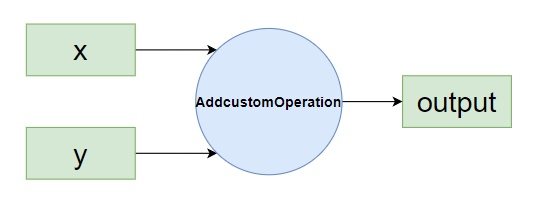

# Single Operator Example Using the Ascend Boost Comm Library

This tutorial uses the add operator as an example to provide a guide for writing operators that run on Ascend Boost Comm.

### Operator Function

Add corresponding elements of two input tensors to produce one output tensor:
`z[i] = x[i] + y[i]`. The test in this tutorial uses one-dimensional FP16 tensors
with the same shape. `OpParam::Addcustom` has no dimension parameter, so the
operator parameters in the test should be an empty dictionary `{}`.

### New Files

- Create the `addcustom` directory under `example/ops`. This directory primarily stores the operator implementation code. See the following sections for the specific file contents. The directory structure is as follows:
    ```
    addcustom
    ├── op_kernel                       // Device-side implementation files (including kernel entry and implementation files)
    │   └── addcustom.cpp
    ├── tiling                          // New operator tiling
    │   ├── addcustom_tiling.cpp        // Core tiling implementation algorithm
    │   ├── addcustom_tiling.h          // Operator tiling interface
    │   └── tiling_data.h              // Definition of the tiling_data structure passed between tiling and kernel
    ├── CMakeLists.txt                  // CMake file for the new operator build
    ├── addcustom_kernel.cpp            // Validation
    └── addcustom_operation.cpp         // Shape validation
    ```

- Create the `example/include/atbops/params/addcustom.h` file to define the parameter structure for the `Addcustom` operation. The content is as follows:
    ```c++
    #ifndef ATBOPS_PARAMS_ADDCUSTOM_H
    #define ATBOPS_PARAMS_ADDCUSTOM_H

    #include <cstdint>
    #include <string>
    #include <sstream>
    #include <mki/utils/SVector/SVector.h>

    namespace Mki {
    namespace OpParam {
    struct Addcustom {

        bool operator==(const Addcustom &other) const
        {
            (void)other;
            return true;
        }
    };

    } // namespace OpParam
    } // namespace Mki

    #endif
    ```
### Modified Files

- Include the new header file `example/include/atbops/params/addcustom.h` in `example/include/atbops/params/params.h`:
    ```c++
    #include "atbops/params/addcustom.h"
    ```
## Environment Preparation

Refer to [Environment Preparation](../README_en.md#environment-setup) to set up the build and test environment. Once the environment is ready, you can begin developing the operator.
## Operator Implementation

Operator implementation mainly includes device-side operator implementation and host-side tiling implementation.
### Tiling Development

Core concepts of tiling development include `TilingData`, `Workspace`, `TilingKey`, `BlockDim`, and more. For details, see [Glossary - Ascend Community](https://www.hiascend.com/document/detail/en/canncommercial/82RC1/opdevg/Ascendcopdevg/atlas_ascendc_10_00013.html).

#### tiling_data.h

File path: `example/ops/addcustom/tiling/tiling_data.h`
Main function: Describes the structured data definitions required for tiling computation.

```c++
#ifndef ATBOPS_ADDCUSTOM_TILING_DATA
#define ATBOPS_ADDCUSTOM_TILING_DATA

#include <cstdint>

namespace Mki {
// Minimum element count per core. For half this is 16 elements on a 32B boundary;
// a larger split granularity is used here.
constexpr uint32_t ADDCUSTOM_MIN_BLOCK_LENGTH = 32;
// DataCopy requires the half element count to be 32-byte aligned.
constexpr uint32_t ADDCUSTOM_ELEM_ALIGN = 16;
// Inter-core splits are aligned to a 64B cache line (32 half elements) so that
// different cores never write the same cache line.
constexpr uint32_t ADDCUSTOM_BLOCK_ALIGN = 32;
// The three half UB buffers (x/y/z) take about 96KB, so one tile is 16384 aligned elements.
constexpr uint32_t ADDCUSTOM_MAX_TILE_LENGTH = 16384;

struct AddcustomTilingData {
    uint32_t totalLength;   // Total data length
    uint32_t formerNum;     // Number of front cores with aligned splits (blockDim-1 when blockDim>1)
    uint32_t formerLength;  // Element count on each front core, a multiple of ADDCUSTOM_BLOCK_ALIGN
    uint32_t tailLength;    // Element count on the last core, which takes the remainder
};

// Element range handled by a single core.
struct AddcustomBlockRange {
    uint32_t start;
    uint32_t length;
};

// Per-core tiling plan: alignLength goes through DataCopy, the remaining tail goes through UB.
struct AddcustomTilePlan {
    uint32_t tileLength;
    uint32_t alignLength;
};

// Shared by host and kernel code, so it has to compile in both environments.
#if defined(__CCE_AICORE__) || defined(__CCE_KT_TEST__)
#define ADDCUSTOM_FN __aicore__ inline
#else
#define ADDCUSTOM_FN inline
#endif

// The first formerNum cores each handle formerLength elements (start and length are 64B aligned),
// the remaining cores handle tailLength elements.
ADDCUSTOM_FN AddcustomBlockRange GetAddcustomBlockRange(const AddcustomTilingData &tiling, uint32_t blockIdx)
{
    AddcustomBlockRange range{0, 0};
    if (blockIdx < tiling.formerNum) {
        range.length = tiling.formerLength;
        range.start = static_cast<uint32_t>(static_cast<uint64_t>(blockIdx) * tiling.formerLength);
    } else {
        range.length = tiling.tailLength;
        uint64_t start = static_cast<uint64_t>(tiling.formerNum) * tiling.formerLength +
                         static_cast<uint64_t>(blockIdx - tiling.formerNum) * tiling.tailLength;
        range.start = static_cast<uint32_t>(start);
    }
    return range;
}

// The aligned part uses vector DataCopy; the non-aligned tail is moved through a UB block
// (DataCopyPad on 910B) so it never shares a cache line with the scalar write-back of the aligned part.
ADDCUSTOM_FN AddcustomTilePlan MakeAddcustomTilePlan(uint32_t blockLength)
{
    AddcustomTilePlan plan{0, 0};
    plan.alignLength = blockLength / ADDCUSTOM_ELEM_ALIGN * ADDCUSTOM_ELEM_ALIGN;
    if (plan.alignLength == 0) {
        return plan;
    }
    plan.tileLength = plan.alignLength < ADDCUSTOM_MAX_TILE_LENGTH ? plan.alignLength : ADDCUSTOM_MAX_TILE_LENGTH;
    return plan;
}

#undef ADDCUSTOM_FN
}  // namespace Mki
#endif
```

#### addcustom_tiling.h
File path: `example/ops/addcustom/tiling/addcustom_tiling.h`
Main function: The tiling process primarily performs data partitioning. This file contains function declarations.
```c++
#ifndef ATBOPS_ADDCUSTOM_TILING_H
#define ATBOPS_ADDCUSTOM_TILING_H

#include <mki/kernel_info.h>
#include <mki/launch_param.h>
#include <mki/utils/status/status.h>

#include <cstdint>

#include "tiling_data.h"

namespace Mki {
// Computes the per-core split from the total length and vector core count; host and kernel share the same offset math.
Status BuildAddcustomTiling(uint32_t totalLength, uint32_t coreNum, AddcustomTilingData &tilingData,
                            uint32_t &blockDim);
Status AddcustomTiling(const LaunchParam &launchParam, KernelInfo &kernelInfo);
}  // namespace Mki

#endif  // ATBOPS_ADDCUSTOM_TILING_H
```

#### addcustom_tiling.cpp
File path: `example/ops/addcustom/tiling/addcustom_tiling.cpp`
Main function: Implements the main function for data partitioning. Refer to the content under the file paths above for specific function implementations.
```c++
#include "addcustom_tiling.h"

#include <mki/utils/assert/assert.h>
#include <mki/utils/log/log.h>
#include <mki/utils/platform/platform_info.h>

#include <algorithm>
#include <cstdint>
#include <limits>

#include "atbops/params/addcustom.h"
#include "tiling_data.h"

// Splitting constants (ADDCUSTOM_MIN_BLOCK_LENGTH, ADDCUSTOM_ELEM_ALIGN,
// ADDCUSTOM_BLOCK_ALIGN, ADDCUSTOM_MAX_TILE_LENGTH) are defined in tiling_data.h.

namespace Mki {
// Computes the per-core split from the total length and vector core count; host and kernel share the same offset math.
Status BuildAddcustomTiling(uint32_t totalLength, uint32_t coreNum, AddcustomTilingData &tilingData,
                            uint32_t &blockDim)
{
    // Refer to the content under the file paths above for specific function implementations
}

Status AddcustomTiling(const LaunchParam &launchParam, KernelInfo &kernelInfo)
{
    // Refer to the content under the file paths above for specific function implementations
}
} // namespace Mki
```

### Kernel Development

For kernel-related concepts such as `Compute`, `CopyIn`, and `CopyOut`, see [Glossary - Ascend Community](https://www.hiascend.com/document/detail/en/canncommercial/82RC1/opdevg/Ascendcopdevg/atlas_ascendc_10_00013.html).
#### addcustom.cpp
File path: `example/ops/addcustom/op_kernel/addcustom.cpp`
Main function: Handles all data movement and computation based on the tiling information.
```c++
#include "kernel_operator.h"
#include "ops/utils/common/kernel/kernel_utils.h"
#include "ops/addcustom/tiling/tiling_data.h"

static constexpr uint32_t BUFFER_NUM = 1;

class Addcustom {
public:
    __aicore__ inline Addcustom() {}
    __aicore__ inline void Init(GM_ADDR x, GM_ADDR y, GM_ADDR z, const Mki::AddcustomTilingData &tiling)
    {
        // Process by block start and actual length, and cover the tail elements. See the file path above.
    }
    __aicore__ inline void Process()
    {
        // Refer to the content under the file paths above for specific function implementations
    }

private:
    // Aligned range: GM -> UB -> vector Add -> GM, lengths are ADDCUSTOM_ELEM_ALIGN aligned.
    __aicore__ inline void ProcessVector()
    {
        // Refer to the content under the file paths above for specific function implementations
    }
    // Ascend910B: the tail block is moved through UB with DataCopyPad so it never shares a cache line with DataCopy.
    __aicore__ inline void ProcessTailPad()
    {
        // Refer to the content under the file paths above for specific function implementations
    }
    // Ascend910 has no DataCopyPad; a non-aligned tail makes the whole block run scalar.
    __aicore__ inline void ProcessScalar(uint32_t offset, uint32_t len)
    {
        // Refer to the content under the file paths above for specific function implementations
    }
    __aicore__ inline void CopyIn(uint32_t offset, uint32_t len)
    {
        // Refer to the content under the file paths above for specific function implementations
    }
    __aicore__ inline void Compute(uint32_t len)
    {
        // Refer to the content under the file paths above for specific function implementations
    }
    __aicore__ inline void CopyOut(uint32_t offset, uint32_t len)
    {
        // Refer to the content under the file paths above for specific function implementations
    }

private:
    AscendC::TPipe pipe;
    AscendC::TQue<AscendC::QuePosition::VECIN, BUFFER_NUM> inQueueX, inQueueY;
    AscendC::TQue<AscendC::QuePosition::VECOUT, BUFFER_NUM> outQueueZ;
    AscendC::GlobalTensor<half> xGm;
    AscendC::GlobalTensor<half> yGm;
    AscendC::GlobalTensor<half> zGm;
    uint32_t blockLength{0};
    uint32_t alignLength{0};
    uint32_t tileLength{0};
};

inline __aicore__ void InitTilingData(const __gm__ uint8_t *p_tilingdata, Mki::AddcustomTilingData *tilingdata)
{
    // Refer to the content under the file paths above for specific function implementations
}

extern "C" __global__ __aicore__ void addcustom(GM_ADDR x, GM_ADDR y, GM_ADDR z, GM_ADDR tiling)
{
    // Refer to the content under the file paths above for specific function implementations
}
```

#### addcustom_kernel.cpp
File path: `example/ops/addcustom/addcustom_kernel.cpp`
Main function: Performs input and output checks and initializes the device side before launching the device-side implementation.
```c++
#include <mki/base/kernel_base.h>
#include <mki_loader/op_register.h>
#include <mki/utils/assert/assert.h>
#include <mki/utils/log/log.h>
#include "atbops/params/params.h"
#include "ops/addcustom/tiling/addcustom_tiling.h"
#include "ops/addcustom/tiling/tiling_data.h"

namespace Mki {

class AddcustomKernel : public KernelBase {
public:
    explicit AddcustomKernel(const std::string &kernelName, const BinHandle *handle) noexcept
        : KernelBase(kernelName, handle)
    {
    }

    /* ---------- Framework Callbacks ---------- */
    bool CanSupport(const LaunchParam &launchParam) const override
    {
        // Refer to the content under the file paths above for specific function implementations
    }

    uint64_t GetTilingSize(const LaunchParam &launchParam) const override
    {
        // Refer to the content under the file paths above for specific function implementations
    }

    Status InitImpl(const LaunchParam &launchParam) override
    {
       // Refer to the content under the file paths above for specific function implementations
    }
};

/* ---------- Register with the Framework ---------- */
REG_KERNEL_BASE(AddcustomKernel);

}   // namespace Mki
```
#### addcustom_operation.cpp

File path: `example/ops/addcustom/addcustom_operation.cpp`
Main function: Defines the behaviors of the Operation, which is the highest level of abstraction for an op under the Ascend Boost Comm framework, including the strategy for selecting the best kernel.

```c++
#include <mki/base/operation_base.h>
#include <mki_loader/op_register.h>
#include <mki/utils/log/log.h>
#include "atbops/params/params.h"

namespace Mki {
using namespace Mki;

static constexpr int32_t INPUT_NUM  = 2;
static constexpr int32_t OUTPUT_NUM = 1;

class AddcustomOperation : public OperationBase {
public:
    explicit AddcustomOperation(const std::string &opName) noexcept : OperationBase(opName) {}

    /* ---------- Select the Best Kernel Strategy ---------- */
    Kernel *GetBestKernel(const LaunchParam &launchParam) const override
    {
        // Refer to the content under the file paths above for specific function implementations
    }

    /* ---------- Number of Tensors ---------- */
    int64_t GetInputNum(const Any &specificParam) const override
    {
        // Refer to the content under the file paths above for specific function implementations
    }

    int64_t GetOutputNum(const Any &specificParam) const override
    {
        // Refer to the content under the file paths above for specific function implementations
    }

protected:
    /* ---------- Shape Inference ---------- */
    Status InferShapeImpl(const LaunchParam &launchParam,
                          SVector<Tensor> &outTensors) const override
    {
        // Refer to the content under the file paths above for specific function implementations
    }
};

/* ---------- Registration ---------- */
REG_OPERATION(AddcustomOperation);

}  // namespace Mki
```

## Build and Test

### CMakeLists.txt
File path: `example/ops/addcustom/CMakeLists.txt`
Main function: File compilation.
```
set(addcustom_srcs
    ${CMAKE_CURRENT_LIST_DIR}/addcustom_operation.cpp
    ${CMAKE_CURRENT_LIST_DIR}/addcustom_kernel.cpp
    ${CMAKE_CURRENT_LIST_DIR}/tiling/addcustom_tiling.cpp
)

add_operation(AddcustomOperation "${addcustom_srcs}")

add_kernel(addcustom ascend910 vector
    op_kernel/addcustom.cpp
    AddcustomKernel)

add_kernel(addcustom ascend910b vector
    op_kernel/addcustom.cpp
    AddcustomKernel)
```

### Operator Build and Environment Variable Setup
The build script for the Ascend Boost Comm repository is `scripts/build.sh`. Before running operator tests for the first time, you need to build the test framework (testframework). If your local environment has **GCC ≥ 12**, append `--no_werror` to the command. For details, see [README Build Instructions](../README_en.md#compilation):
```shell
bash scripts/build.sh testframework
```
Then build the operators in the example directory:
```shell
bash scripts/build.sh example
```
After building, set the environment variables:
```shell
source output/mki/set_env.sh
```

### Debug Logging

Use `MKI_LOG(INFO) << "..."` in operator code to print debug information. See `example/ops/addcustom/tiling/addcustom_tiling.cpp` for usage.

**Note**: MKI logs output only ERROR and above by default, and are not printed to the terminal by default. When you run the sample as described above, a newly added `MKI_LOG(INFO)` line produces no visible output even though the code does run.

The related environment variables are described below:

| Environment Variable | Value | Description |
|---|---|---|
| `ASCEND_GLOBAL_LOG_LEVEL` | `0`=TRACE (including DEBUG), `1`=INFO, `2`=WARN, `3`=ERROR (default), `4`=logging disabled | Global log level. Only logs at or above this level are output. |
| `ASCEND_SLOG_PRINT_TO_STDOUT` | `1` | Also print logs to the terminal. If not set, logs are written to a file only. |
| `ASCEND_MODULE_LOG_LEVEL` | For example, `OP=1` | Overrides the global log level when set. The key must be `OP`; other keys have no effect. Note that it applies to the whole process, not only to logs emitted inside the OP module. |

To print INFO-level logs to the terminal:

```shell
export ASCEND_GLOBAL_LOG_LEVEL=1
export ASCEND_SLOG_PRINT_TO_STDOUT=1
python example/tests/pythontest/optest/test_addcustom.py
```

If you set only `ASCEND_GLOBAL_LOG_LEVEL=1` without `ASCEND_SLOG_PRINT_TO_STDOUT`, logs are not printed to the terminal. They are written to a log file instead.

The log directory is resolved in the following order of precedence:

| Environment Variable (highest to lowest) | Log Directory |
|---|---|
| `ASCEND_PROCESS_LOG_PATH` | `$ASCEND_PROCESS_LOG_PATH/atb/` |
| `ASCEND_WORK_PATH` | `$ASCEND_WORK_PATH/log/atb/` |
| Neither is set | `$HOME/ascend/log/atb/` |

Log file names use the format `atb_<pid>_<timestamp>.log`, for example `$HOME/ascend/log/atb/atb_12345_20261113170000.log`.

> **Troubleshooting**: If no logs appear even after you set the log level, verify that the disk holding the log directory has more than 10 GB free (if less than 10 GB is available, file logging is skipped). Also note that if the code emits only logs below the current level (for example, only one `MKI_LOG(INFO)` at the default level), no log file is created at all.

### Testing
To test the operator you have written, create `test_addcustom.py` under the `example/tests/pythontest/optest/` directory:
```python
import os
import unittest
import numpy as np
import torch
import sys
import logging

sys.path.append(f"{os.environ['MKI_HOME_PATH']}/tests/pythontest")
import op_test


OP_NAME = "AddcustomOperation"
OP_PARAM0 = {}


class TestAddcustom(op_test.OpTest):
    def golden_calc(self, in_tensors):
        a = in_tensors[0]
        b = in_tensors[1]
        return [a + b]

    def golden_compare(self, out_tensors, golden_out_tensors):

        return torch.allclose(out_tensors[0], golden_out_tensors[0], rtol=0.001, atol=0.001)

    def test_2d_half(self):
        shape = (2 * 16,)
        a = torch.randn(shape).to(torch.float16)
        b = torch.randn(shape).to(torch.float16)

        self.set_param(OP_NAME, OP_PARAM0)
        self.execute([a, b], [torch.ones(shape).to(torch.float16)])


if __name__ == '__main__':
    unittest.main()

```
Run the test script with the following command:
```shell
python example/tests/pythontest/optest/test_addcustom.py
```
